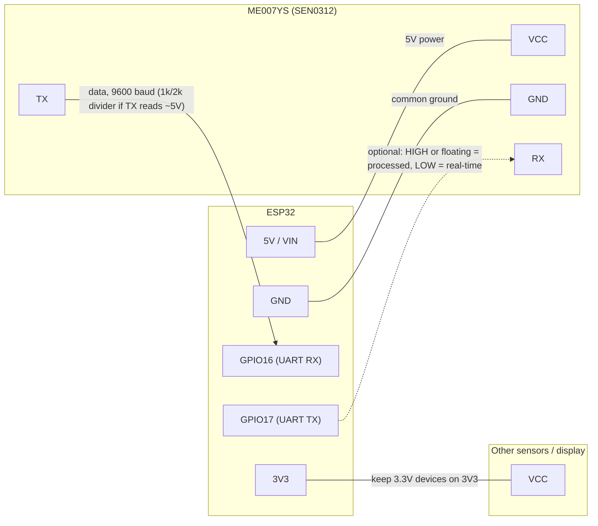

# ME007YS Ultrasonic Distance Sensor (ESPHome External Component)

An ESPHome external component for the **DFRobot SEN0312 / DYP-ME007YS** waterproof ultrasonic distance sensor.  
Reads the sensor over UART and publishes distance in **centimeters**, with built-in range validation, guard band filtering, step limiting, and optional diagnostics.

## Features
- UART parsing: `0xFF, HIGH, LOW, CHECKSUM`
- Distance in **centimeters** (0.1 cm)
- Range enforcement: `min_valid_cm` (default 28.0), `max_valid_cm` (default 450.0)
- Lower bound behavior: `too_close_behavior` = `nan|min|last`
- Upper bound: always **NaN** + status `too_far`
- Robustness:
  - `guard_cm` — ignore a band above `min_valid_cm` (default 5.0)
  - `max_step_cm` -- hold back spikes; a sustained change becomes the new level (0=off)
  - `require_consecutive` -- confirm a new level over N similar frames
- Diagnostics:
  - `frame_rate_hz` (Hz), `status` text (`ok`, `settling`, `too_close`, `too_far`, `checksum_error`, `idle`)
  - `raw_mm` (mm) with `raw_mm_policy: all|valid_only`
- Optional `debug_raw` for byte-level logging

## Repository layout
Follows the [ESPHome external components](https://esphome.io/components/external_components/) layout, so ESPHome finds the component with no extra `path:` option:

```
components/
  me007ys/
    __init__.py
    sensor.py
    me007ys_sensor.cpp
    me007ys_sensor.h
examples/
  me007ys_esp32c3.yaml
```

## Installation

### 1. Add the component to your device YAML
```yaml
external_components:
  - source: github://HritwikSinghal/esphome-me007ys-sensor
    components: [me007ys]
```

To pin a branch or tag, append `@<ref>`: `github://HritwikSinghal/esphome-me007ys-sensor@main`.

Equivalent long form (useful with `refresh:` or a fork):
```yaml
external_components:
  - source:
      type: git
      url: https://github.com/HritwikSinghal/esphome-me007ys-sensor
      ref: main
    refresh: 1d
    components: [me007ys]
```

### 2. Wire the sensor
| Sensor | ESP |
|---|---|
| VCC | 5V |
| GND | GND |
| TX  | UART RX pin (`rx_pin`) |
| RX  | optional, see below |



The sensor's RX pin selects its output mode, not a command channel:
- **Floating or HIGH**: processed (filtered) value every 100-300 ms. Recommended.
- **LOW**: real-time value every 100 ms.

Leave it unconnected unless you want real-time mode. If you do wire it to the ESP `tx_pin`, nothing else may transmit on that pin: a UART TX idles HIGH, so the sensor stays in processed mode.

**Check the TX voltage.** The sensor runs on 5V and DFRobot does not state its TX output level. ESP32 GPIOs are not 5V-tolerant. Measure sensor TX to GND while idle: about 3.3V is safe; about 5V needs a divider (1 kOhm in series from TX, 2 kOhm from the ESP `rx_pin` to GND) or a level shifter. Keep other 3.3V devices on the same board (I2C sensors, displays) on 3V3, and tie all grounds together.

**Avoid the logger's UART pins.** On a classic ESP32 the logger uses UART0 (TX GPIO1, RX GPIO3) at 115200 baud by default. Sharing those pins sends log traffic into the sensor. Either use other pins (as below) or disable serial logging with `logger: baud_rate: 0` (logs still stream over Wi-Fi). On ESP32-C3 UART0 is GPIO20/21, so GPIO1/3 are free there.

### 3. Configure UART and the sensor
```yaml
uart:
  id: uart_me007ys
  tx_pin: GPIO17     # ESP TX -> sensor RX (optional, see wiring)
  rx_pin: GPIO16     # ESP RX <- sensor TX
  baud_rate: 9600
  rx_buffer_size: 256

sensor:
  - platform: me007ys
    uart_id: uart_me007ys
    name: "Water Level Distance (cm)"
    min_valid_cm: 28.0
    max_valid_cm: 450.0
    too_close_behavior: nan
    guard_cm: 0.0
    max_step_cm: 120.0        # spikes held back; a real change is accepted after 3 agreeing frames
    require_consecutive: 2
    raw_mm:
      name: "ME007YS Raw Distance (mm)"
    raw_mm_policy: all   # show every reading while setting up; switch to valid_only later
    frame_rate_hz:
      name: "ME007YS Frame Rate"
    status:
      name: "ME007YS Status"
```

Readings under `min_valid_cm + guard_cm` (28 cm here) report NaN with status `too_close`. Raise `guard_cm` only if you see false readings just above the blind zone.

A full device config (ESP32-C3, plus an inches template sensor) is in [`examples/me007ys_esp32c3.yaml`](examples/me007ys_esp32c3.yaml).

### 4. Compile and flash
Install from the ESPHome dashboard, or `esphome run <your-device>.yaml`.

## Configuration options
All standard [sensor](https://esphome.io/components/sensor/) options also apply.

| Option | Default | Description |
|---|---|---|
| `uart_id` | -- | UART bus the sensor is on (required if more than one UART). |
| `update_interval` | `500ms` | How often states are published (one per interval, from the latest frame). Frames are parsed continuously. |
| `min_valid_cm` | `28.0` | Lower limit; the sensor's blind zone is 0-28 cm. Effective cutoff is `min_valid_cm + guard_cm`. |
| `max_valid_cm` | `450.0` | Readings at or above this publish NaN with status `too_far`. |
| `too_close_behavior` | `nan` | `nan`, `min` (publish `min_valid_cm`) or `last` (hold last value). |
| `guard_cm` | `5.0` | Extra band above `min_valid_cm` also treated as too close. |
| `max_step_cm` | `0.0` | Hold back jumps larger than this from the last accepted value; a jump that persists for `max(require_consecutive, 3)` agreeing frames is accepted as the new level. `0` disables. |
| `require_consecutive` | `1` | A new level is published once N consecutive frames agree within 1 cm (1-10); after that every agreeing frame publishes. |
| `raw_mm` | -- | Optional sensor: raw distance in mm after checksum check. |
| `raw_mm_policy` | `all` | `all` or `valid_only` (NaN when out of range). |
| `frame_rate_hz` | -- | Optional sensor: frames parsed per `update_interval`. |
| `status` | -- | Optional text sensor: `ok`, `too_close`, `too_far`, `checksum_error`, `idle` (no frames this interval), `settling` (in range, waiting for confirmation). Published only on change. |
| `debug_raw` | `false` | Log every frame at DEBUG level. |

## Troubleshooting
- **"Could not find components folder for source"**: the source repo has no `components/` or `esphome/components/` folder. Versions of this repo before the rename used `external_components/`; ESPHome caches git sources for a day by default, so run **Clean Build Files** in the dashboard (or set `refresh: 0s` once) to pick up the new layout.
- **Build fails with `text_sensor/text_sensor.h: No such file or directory`**: you are building a cached copy of this repo from before the fix. Set `refresh: 0s` on the source (long form above) or run **Clean Build Files**, rebuild, then restore `refresh: 1d`.
- **Status stays `idle`**: no bytes are arriving. Check that sensor TX goes to the ESP `rx_pin`, the sensor has 5V, the baud rate is 9600, and the logger is not on the same pins (see wiring).
- **Status `too_close` and distance is NaN**: frames are arriving and pass the checksum, but the reading is under `min_valid_cm + guard_cm`. Set `raw_mm_policy: all` to see the actual reading in mm, then either move the sensor so the target is further away, check the beam is not hitting a wall or pipe, or lower `guard_cm`.
- **Frame rate around 2 Hz**: observed on a working unit in processed mode; not a fault. The datasheet quotes a 100-300 ms response time, but real output is slower.
- **Frequent `checksum_error`**: check wiring and grounding; long unshielded runs pick up noise.
- **Raw distance often exactly 280 mm**: the sensor reports its 28 cm floor when it cannot get a proper echo, i.e. something is in the 0-28 cm blind zone or the beam hits a nearby wall, pipe or lid. Remount further from the surface or aim it straighter.
- **Status `settling` and the distance does not change**: readings are in range but not confirmed yet. Expected for a few frames after a jump with `require_consecutive` or `max_step_cm`; if it persists, readings are jittering more than 1 cm. Lower `require_consecutive` or add a `median` filter.

